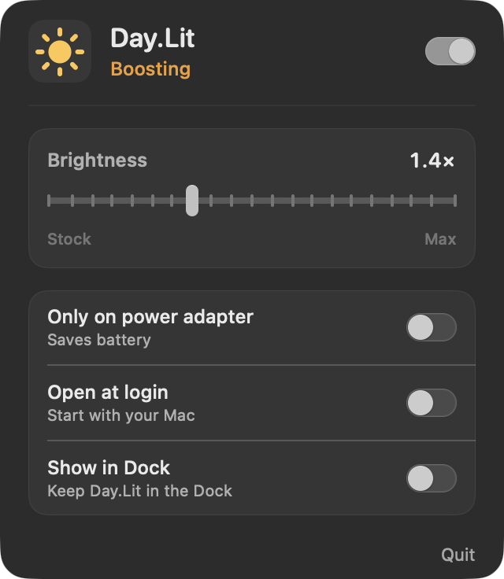

# Day.Lit

A lightweight macOS app that adds brightness headroom on supported XDR displays.

<p align="center">
  
</p>

[github.com/elija-7580/Day.Lit](https://github.com/elija-7580/Day.Lit)

## Requirements

- MacBook Pro 14″ / 16″ with M-series Pro or Max, or Pro Display XDR
- macOS 13+

## Install

```bash
git clone https://github.com/elija-7580/Day.Lit.git
cd Day.Lit
make run
```

Or:

```bash
make app
open ".build/Day.Lit.app"
```

Unsigned builds may need **System Settings → Privacy & Security → Open Anyway** once.

## Features

- Adjust boost intensity with the slider (1.0×–2.0×)
- Optional power-adapter-only mode and launch at login
- Menu bar control, with an optional Dock icon
- Closing the panel leaves Day.Lit running

Click the sun icon in the menu bar to open or close the control panel.

## Low-resource design

1×1 EDR Metal primer + one gamma table write. Idle cost is near zero.

## License

Released under the [MIT License](LICENSE).
